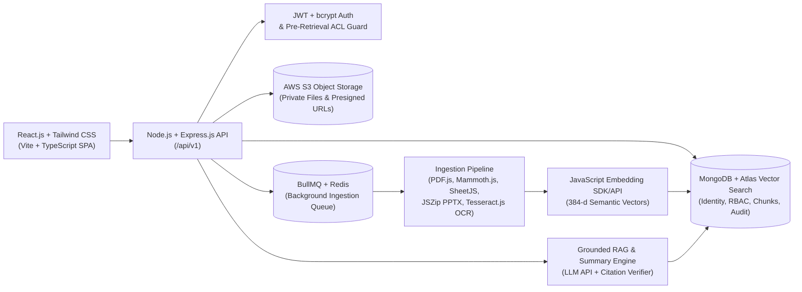

# SUMIND-IQ System Architecture

## 1. High-Level System Overview

SUMIND-IQ is a full-stack **Node.js / TypeScript** enterprise AI knowledge management platform engineered for strict multi-tenant isolation, pre-retrieval role-based access control (RBAC), verifiable citations, and asynchronous multi-format document processing.

---

## 2. Technology Stack by Layer

| Layer | Technology | Responsibility |
| :--- | :--- | :--- |
| **Frontend** | React.js + Tailwind CSS + TanStack Query + Recharts | Role-aware UI, Citation Inspector, Document Library, Analytics, and Admin Governance |
| **Backend** | Node.js + Express.js (TypeScript) | REST API (`/api/v1/*`), RBAC middleware, rate limiting, and OpenAPI documentation (`/api/docs`) |
| **Database** | MongoDB | Unified document store for organisations, users, memberships, documents, chunks, summaries, conversations, feedback, jobs, and audit logs |
| **Authentication** | JWT (`jsonwebtoken`) + `bcryptjs` | bcrypt credential hashing, short-lived JWT access tokens, revocable refresh token rotation, and signed download tokens |
| **AI Integration** | LLM API (Gemini API + Extractive Verifier) | Grounded Q&A synthesis with strict `[Source N]` citation verification and automatic refusal on insufficient evidence |
| **Embeddings** | JavaScript Embedding SDK/API | Generates 384-dimensional dense semantic vectors for chunks and user queries |
| **Vector Search** | MongoDB Atlas Vector Search (`$vectorSearch`) | Pre-filtered cosine similarity search fused with lexical keyword overlap scoring |
| **Document Processing** | PDF.js (`pdfjs-dist`), Mammoth.js (`mammoth`), SheetJS (`xlsx`), JSZip (`pptx`) | Extracts clean text while preserving `Page N`, `Slide N`, `Sheet '...'`, and `Section N` location labels |
| **OCR** | Tesseract.js (`tesseract.js`) | Pure JavaScript/WASM optical character recognition fallback for scanned PDFs |
| **File Storage** | AWS S3 (`@aws-sdk/client-s3` + presigner) | Private object storage with short-lived presigned URLs and local disk caching/fallback |
| **Background Jobs** | BullMQ + Redis (`bullmq` + `ioredis`) | Asynchronous document ingestion and idempotent retries with in-process worker fallback |

---

## 3. Document Ingestion & Indexing Pipeline

1. **Upload & Validation**: Express `multer` receives multipart payloads and runs extension, file-size, MIME, and magic-byte container validation (`%PDF-`, PK ZIP signatures for Office OpenXML, null-byte guard for `.txt`).
2. **Checksum & Storage**: Computes SHA-256 checksum and stores the file in AWS S3 (or local private storage fallback) with a randomized filename.
3. **Queue Dispatch**: Creates a `processing_jobs` record and enqueues the job in **BullMQ + Redis** (or executes via the in-process worker fallback in local development).
4. **Extraction & OCR**:
   - **PDF** -> **PDF.js** (`pdfjs-dist`) page-by-page extraction, falling back to **Tesseract.js** OCR when text streams are absent.
   - **DOCX** -> **Mammoth.js** section extraction.
   - **XLSX** -> **SheetJS** multi-sheet tabular extraction.
   - **PPTX** -> **JSZip** slide XML text extraction.
   - **TXT** -> UTF-8 heading/section parser.
5. **Overlapping Chunking**: Splits sections into configurable character windows with overlap while preserving exact source location metadata (`location_label`, `page_number`, `slide_number`, `sheet_name`, `section_title`).
6. **Vectorization & Indexing**: Generates 384-d embeddings via the JavaScript Embedding SDK/API and atomically replaces `document_chunks` and `document_structures` in MongoDB so reprocessing never leaves duplicate chunks.

---

## 4. Documented Local Development Fallbacks

When external cloud/daemon services (`MongoDB`, `Redis`, `AWS S3`, `LLM_API_KEY`) are not provisioned on a local developer machine, SUMIND-IQ activates transparent fallbacks and reports their exact state on `GET /api/v1/health` and the Admin Dashboard:

- **MongoDB**: Falls back to a persistent embedded MongoDB collection store at `backend/data/mongodb_store.json` with exact cosine similarity + lexical hybrid vector search.
- **AWS S3**: Falls back to non-public local storage at `backend/storage/documents/<organisation_id>/` with short-lived JWT-signed download URLs.
- **BullMQ + Redis**: Falls back to an in-process async/sync worker dispatcher.
- **LLM API**: Falls back to the deterministic zero-hallucination extractive grounded verifier when `LLM_API_KEY` is omitted.
