# SUMIND-IQ — System Architecture

## 1. Architectural Overview

**SUMIND-IQ** is a multi-tenant, role-aware organisational knowledge management and Retrieval-Augmented Generation (RAG) platform. It ingests heterogeneous corporate files (`PDF`, `DOCX`, `PPTX`, `XLSX`, `TXT`), preserves granular source locations (`Page N`, `Slide N`, `Sheet '...'`, `Section N`), indexes dense vector embeddings alongside lexical tokens, and synthesizes answers strictly grounded in retrieved document evidence.

```mermaid
flowchart TD
    Client["React 18 + TypeScript + Vite SPA"]
    Gateway["FastAPI REST API (/api/v1)"]
    RBAC["RBAC, Tenant Isolation & Permission Filter"]
    PG[("PostgreSQL 16 + pgvector\n(Identity, RBAC, ACLs, Chunks, Audit)")]
    Mongo[("MongoDB 7\n(Document Structure Trees & Job Telemetry)")]
    Redis[("Redis + Celery Worker\n(Async Document Ingestion Queue)")]
    Parsers["Multi-Format Extractors\n(PyMuPDF, python-docx, python-pptx, openpyxl, Tesseract OCR)"]
    AI["Provider-Agnostic AI Layer\n(Gemini / OpenAI-Compatible / Grounded Extractive Synthesis)"]
    Validator["Citation Validator\n(Maps [Source N] -> Authoritative Chunk ID)"]

    Client -->|JWT Bearer + HTTPS| Gateway
    Gateway --> RBAC
    RBAC --> PG
    Gateway --> Redis
    Redis --> Parsers
    Parsers --> Mongo
    Parsers --> PG
    RBAC -->|Authorised Document IDs Only| AI
    AI --> Validator
    Validator --> Client
```

## 2. Core Subsystems

### 2.1 Permission-First Retrieval-Augmented Generation (RAG)
Unlike naive RAG prototypes that retrieve across an entire vector index and filter afterward (or not at all), SUMIND-IQ executes **Pre-Retrieval Permission Filtering**:
1. `get_authorised_documents(db, ctx)` evaluates the caller's `organisation_id`, `role` (`admin`, `manager`, `employee`), `workspace_ids`, document `visibility` (`organisation`, `workspace`, `restricted`), `allowed_roles`, and explicit `DocumentAccessPolicy` (`allow` / `deny`) rules.
2. Vector cosine similarity and lexical BM25/token scoring (`search_authorised_chunks`) are restricted strictly to chunks belonging to `authorised_document_ids`.
3. Retrieved chunks are wrapped in `<untrusted_document_evidence>` XML delimiters to neutralize indirect prompt-injection attempts inside uploaded documents.
4. `CitationValidator` verifies every `[Source N]` marker emitted by the LLM against the retrieved chunk map and discards any fabricated or out-of-range citation index.
5. When a user reopens a historical conversation (`GET /api/v1/chat/conversations/{id}`), citations are **re-verified** against current document permissions; if access to a cited document was subsequently revoked, its excerpt is masked.

### 2.2 17-Stage Document Ingestion Pipeline
1. Extension and MIME type verification.
2. Magic-byte / ZIP container signature inspection (`%PDF-`, OOXML `[Content_Types].xml`, UTF-8 text validation).
3. Configurable file size enforcement.
4. Safe UUID internal storage filename generation outside public directories.
5. SHA-256 checksum computation and uploader/organisation/ACL persistence in PostgreSQL.
6. `ProcessingJob` creation (`queued`).
7. Asynchronous dispatch via Celery/Redis (with automatic in-process fallback when Redis is absent in local development).
8. Format-specific extraction preserving `Page N`, `Slide N`, `Sheet '...'`, and `Section N` markers.
9. Conditional Tesseract OCR fallback for scanned PDF pages with low native text density.
10. Text normalization and prompt-injection pattern sanitization.
11. Overlapping sliding-window chunk segmentation (`chunk_size_chars`, `chunk_overlap_chars`).
12. Chunk metadata enrichment.
13. 384-dimensional vector embedding generation.
14. Atomic chunk indexing in PostgreSQL (`DocumentChunk`) and structural metadata persistence in MongoDB (`document_structures`).
15. Hierarchical executive and section summary pre-computation (`DocumentSummary`).
16. Transition of document state to `ready` only after searchable chunks are committed.
17. User notification creation and immutable `AuditLog` recording.

## 3. Documented Local Development Fallbacks
When external database daemons (`PostgreSQL`, `MongoDB`, `Redis`) are not running on the developer's host machine:
- **Relational & Vector Store**: Automatically falls back to `sqlite:///.../sumindiq_dev.db` with custom `EmbeddingVector` SQLAlchemy type decorator supporting both PostgreSQL `pgvector` and JSON-serialized float vectors.
- **Document Store**: `ModularMongoRepository` falls back to structured JSON collections in `backend/data/mongo_fallback/`.
- **Job Queue**: `dispatch_ingestion_job` falls back from Celery/Redis to FastAPI background/in-process execution.
- **Transparency**: `/api/v1/health` and `/api/v1/admin/system-config` explicitly report `using_dev_fallback: true` and the exact fallback reason—never silently pretending external daemons are connected when running in local standalone mode.

