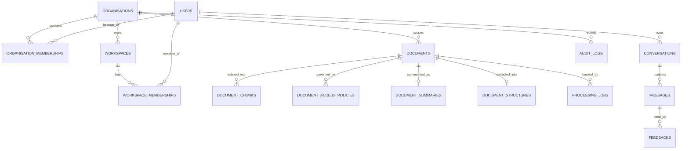

# SUMIND-IQ Database & Vector Search Architecture (MongoDB)

## 1. Unified MongoDB Document & Vector Store

SUMIND-IQ uses **MongoDB** (with **MongoDB Atlas Vector Search**) as its authoritative persistence layer across 20 structured collections managed in `backend/src/db/mongo.ts` and typed in `backend/src/types/models.ts`.

### Collections Overview

| Domain | Collections | Purpose |
| :--- | :--- | :--- |
| **Multi-Tenancy & Identity** | `organisations`, `users`, `organisation_memberships`, `refresh_sessions`, `password_resets` | Tenant isolation, bcrypt password hashes, JWT session rotation, password resets |
| **RBAC & Workspaces** | `roles`, `permissions`, `workspaces`, `workspace_memberships` | Role matrix (`admin`, `manager`, `employee`), team workspace scoping |
| **Document Lifecycle** | `documents`, `document_access_policies`, `document_structures`, `processing_jobs` | File metadata, AWS S3 keys, allow/deny ACL overrides, extracted section trees, BullMQ job status |
| **Vector Search & AI** | `document_chunks`, `document_summaries` | Chunk text with location tags (`Page N`, `Slide N`, `Sheet '...'`), 384-d `embedding` arrays, structured summaries |
| **Assistant & Audit** | `conversations`, `messages`, `feedbacks`, `audit_logs`, `notifications` | Multi-turn RAG transcripts, verified citations, quality feedback, immutable security logs |

---

## 2. Entity Relationships (Logical Schema)



---

## 3. MongoDB Atlas Vector Search Index Configuration

For production deployment on **MongoDB Atlas**, create a Vector Search index named `chunk_vector_index` (configurable via `MONGODB_VECTOR_INDEX_NAME`) on the `document_chunks` collection:

```json
{
  "fields": [
    {
      "type": "vector",
      "path": "embedding",
      "numDimensions": 384,
      "similarity": "cosine"
    },
    {
      "type": "filter",
      "path": "organisation_id"
    },
    {
      "type": "filter",
      "path": "document_id"
    }
  ]
}
```

### Pre-Retrieval Security Filtering
Every `$vectorSearch` query enforces a mandatory pre-filter:
```json
{
  "organisation_id": "<authenticated_org_id>",
  "document_id": { "$in": ["<authorised_doc_ids...>"] }
}
```
This guarantees unauthorized or cross-tenant chunks are never retrieved or passed to the LLM context window.

---

## 4. Embedded Local MongoDB Fallback

When running locally without a `mongod` service or Atlas cluster, `UnifiedMongoStore` (`backend/src/db/mongo.ts`) automatically persists all 20 collections to `backend/data/mongodb_store.json` and runs exact cosine similarity + keyword lexical hybrid ranking in-process, ensuring zero-setup evaluation on any machine.
