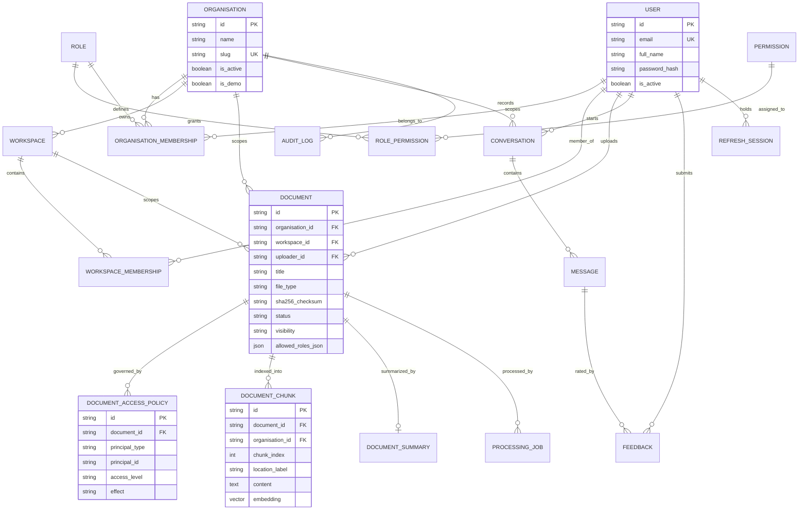

# SUMIND-IQ — Database Schema & Polyglot Persistence

## 1. Authoritative Data Boundaries

- **PostgreSQL (`pgvector`)**: Single authoritative source of truth for identity (`users`, `refresh_sessions`, `password_reset_records`), multi-tenant isolation (`organisations`, `organisation_memberships`, `workspaces`, `workspace_memberships`), RBAC (`roles`, `permissions`, `role_permissions`), document ownership & access policies (`documents`, `document_access_policies`), searchable vector chunks (`document_chunks`), hierarchical summaries (`document_summaries`), RAG conversations (`conversations`, `messages`, `feedbacks`), and tamper-evident audit logs (`audit_logs`).
- **MongoDB**: Stores non-authoritative document-oriented structural extraction metadata (`document_structures`) and verbose ingestion pipeline stage telemetry (`processing_records`). Security-sensitive permissions are never duplicated or trusted from MongoDB.

## 2. Entity-Relationship Diagram (PostgreSQL)



## 3. Migrations & Seeding

- Database migrations are managed via **Alembic** in `backend/migrations/versions/0001_initial_schema.py`.
- Run migrations:
  ```bash
  cd backend
  alembic upgrade head
  ```
- Seed initial roles, permissions, and `[DEMO]` evaluation data:
  ```bash
  cd backend
  python -m app.db.seed
  ```

